<table>
<tr>
<td valign="top"></td>
<td valign="top"></td>
</tr>
</table>

## Armanjit Singh Aujla (Arman)

**CS (AI) @ UAlberta | Aspiring ML Engineer | Founder, NorthCited**

### About me

I am a Computer Science student in the AI specialization at the University of Alberta (started Sept 2026), based in Edmonton. I am working toward a career in machine learning engineering, with a focus on PyTorch and reinforcement learning in the UAlberta and Amii ecosystem.

### Open to

**ML/AI internships for 2027** in Edmonton, Calgary, Vancouver or remote. Feel free to reach out by email or LinkedIn.

### Projects

Projects are coming soon. In the meantime, follow my progress in [learning_log](https://github.com/asaujla2/learning_log).

<!-- contribution graph, refreshed daily by the workflow -->

Profile art built with <a href="https://github.com/mithun50/ascii-profile-kit">ascii-profile-kit</a>.

